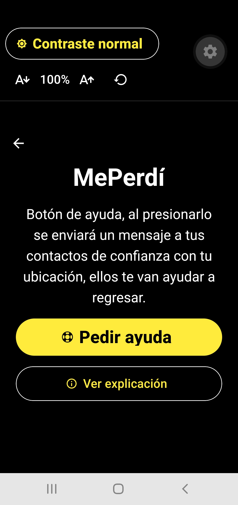
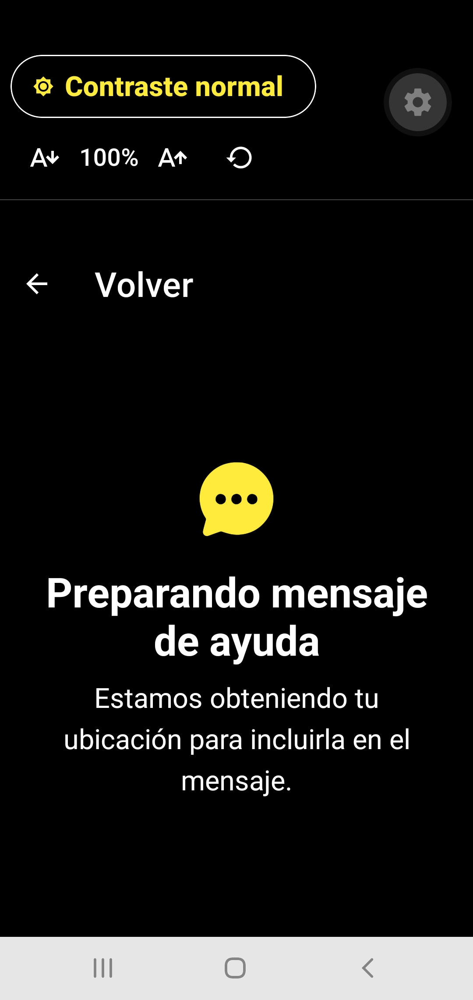
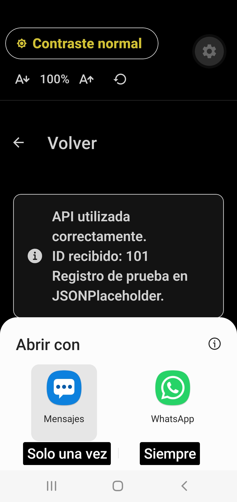
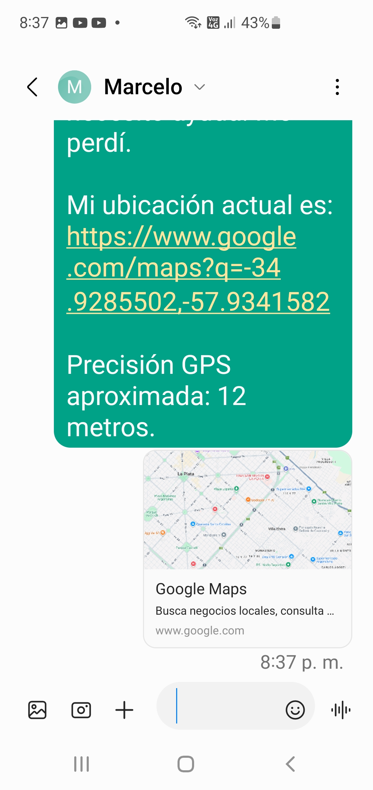
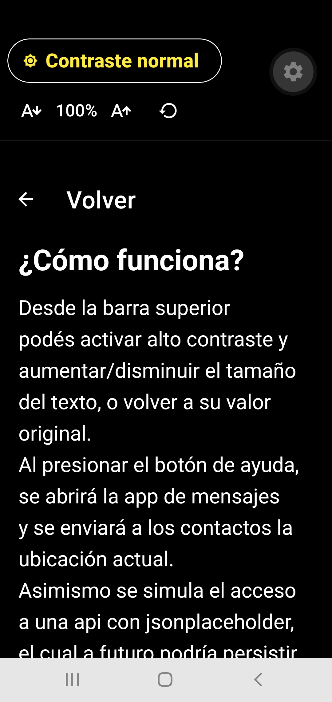
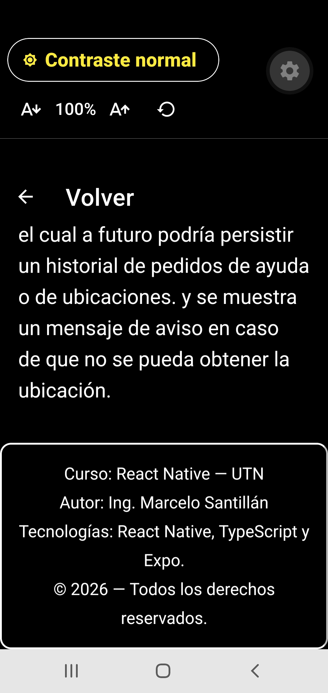
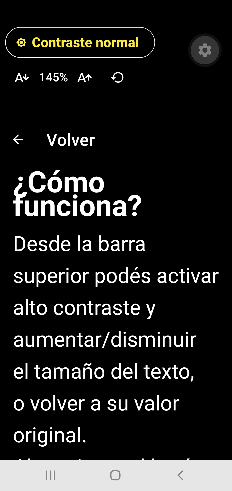
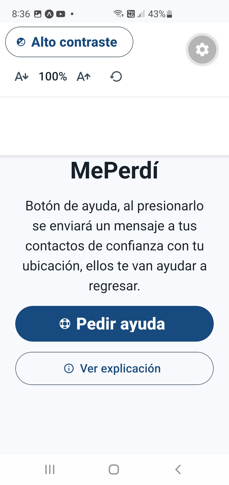

# React Native Expo app para las actividades 3 5 y 6👋

ACLARACION: Tuve que utilizar la sdk 58, debido a que en mi movile expo go solo acepto esa versión. Si bien el profe aclaro que usemos la v54, veo que la actualización es medio automática.

## Idea de la aplicación

Continuando con la idea de una aplicación de ayuda a una persona de la tercera edad, en esta ocasión utilizo como temática el hipotético caso de una persona perdida, o con inconvenientes de orientación. También se podria aplicar a niños u otros grupos. Asimismo como voy a explicar más adelante también podría servir para ubicar personas.

## Modo de uso

Cuando alguien se siente perdido fuera de su hogar, presiona el botón "Pedir ayuda", por medio de la geolocalización se buscan las coordenadas,y precisión de la ubicación, y se arma un mensaje con estos datos y url de google map para abrir un mapa, el cual se pude enviar por medio de un sms a un contacto de confianza.
Como tema la aplicación tiene una vista normal o se cambia por medio de un botón a altocontraste, también es posible aumentar o disminuir el tamaño de la fuente para una mejor visualización.

# Inconvenientes presentados

- solo pude probarlo con la aplicación de mensajería para enviar el sms. Si bien se muestra también la aplicación de Whatasapp no puede ver como aplicarlo.
- la versión de la sdk, solo pude usar la 58.

## Actividades Incluidas

En esta aplicación intento resumir las propuestas de las tres últimas actividades 3, 5 y 6 (no había una 4), perdón por no presentarlo por separado.

- Actividad 3 (Implementación de APIS): Mediante un post se envía un request, dado que se trata de una simulación para que quede registro provisoriamente se muestra un mensaje en pantalla con la invocación. Más adelante la voy a retirar cuando se avance con el desarrollo del proyecto.

- Actividad 5 (Paleta de Marca Personalizada):Como tema desarrollado, opte por vista normal, y alto contraste. El alto contraste considerando una persona con problemas visuales, asimismo considerando ese último inconveniente incluí la posibilidad de poder incrementar o disminuir la fuente para una mejor lectura.

- Actividad 6 (Manipulación Nativa): Utilizo el gps para idenficar las coordenadas de localización de la persona, y luego se enviara un mensaje a un contacto con la ubicación en un mapa.

## Relación de esta presentación con el trabajo Final

Mi idea es seguir desarrollando la idea de esta aplicación con los nuevos temas que se van viendo en el curso por ejemplo
Dado que se va pedir un crud, podría aplicarlo en un abm de contactos de confianza, con nro de telefono, nombre, relación, tal vez un orden de prioridad en el pedido de ayuda.Aqui se aplicaría persistencia tal ves con Firestore.
Drawers donde se pueda incluir el crud, o configuración del usuario
donde se incluya acceso a un form con datos personales o de alguna condición médica a tener en cuenta, como si sufre de ataques de pánico, si es alérgico a alguna medicación, diabético, cardíaco, etc.
AsyncStorage para guardar preferencia de temas, pero también estoy imaginando ir guardando las últimas ubicaciones de tal forma que se pierde
geolocalización se pueda enviar algo aproximado en el mensaje indicando esa condición, y tal vez esa información también persistirla o sincronizarla cuando se recupera señal, en especial estos últimos temas los tengo que analizar y ver su factibilidad.

## Capturas de Pantallas

- Pantalla Inicio: 
- Botón ayuda: 
- Mensaje Enviado (se ve post a una api también): 
- Mensaje Recibido: 
- Pantalla Explicación: 
- Explicación pie: 
- Maximo tamaño fuente: 
- Tema normal: 

This is an [Expo](https://expo.dev) project created with [`create-expo-app`](https://www.npmjs.com/package/create-expo-app).

## Get started

1. Install dependencies

   ```bash
   npm install
   ```

2. Start the app

   ```bash
   npx expo start
   ```

## Créditos

Curso: React Native — UTN

Autor: Ing. Marcelo Santillán

Tecnologías: React Native, TypeScript y Expo.

© 2026 — Todos los derechos reservados.
